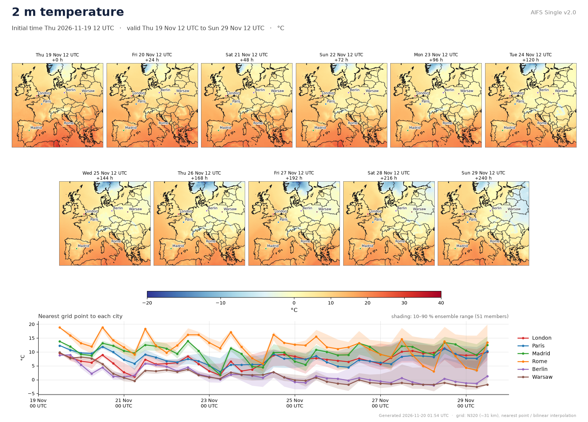

# AIFS weather forecast pipeline

Run ECMWF's machine-learned weather model **AIFS Single v2.0** from the latest real-time
ECMWF open data, and turn the forecast into weather cards. One command does both:

```bash
./predict_now.sh          # newest cycle → 10-day global forecast → weather cards for Germany
```

On a single RTX PRO 6000 (96 GB) the full 10-day forecast takes about **2 min 40 s**, and all
131 cards take another 40 s.

## What it does

1. Finds the newest 00/06/12/18 UTC cycle on [ECMWF open data](https://www.ecmwf.int/en/forecasts/datasets/open-data).
   On the first run it also downloads the model (~1 GB) from Hugging Face.
2. Runs [`ecmwf/aifs-single-2.0`](https://huggingface.co/ecmwf/aifs-single-2.0) with
   [anemoi-inference](https://github.com/ecmwf/anemoi-inference) for 10 days in 6 h steps.
   The output is GRIB on the native N320 grid (~31 km).
3. Renders weather cards for a region (Germany or Europe) and an `index.html` gallery that
   links them all.

## Weather cards

A weather card is one PNG that shows a single forecast at a glance. Each run makes about
130 of them, in two kinds.

**Overview card.** One panel per city (the model grid point nearest to it), all on the same
axes so cities can be compared directly. Times are local.


- Red line: 2 m air temperature.
- Blue bars: rain per 6 h, on the right-hand axis.
- Grey strip on top: total cloud cover, darker means more cloud.
- Arrows at the bottom: 10 m wind direction, with the speed in km/h below.
- Headline: the period's maximum and minimum temperature and total rain.

**Variable cards.** One card per model output: surface fields such as temperature, pressure,
precipitation and wind, 14 pressure levels from 1000 to 10 hPa, ocean waves, and constant
fields such as orography.



- Maps: the field over the region at regular times, once a day at the same hour for a 10-day
  run. All maps share one colour scale (the bar below them).
- Precipitation and other accumulated fields are shown as amounts per period (for example
  daily totals), so no rain falls between two maps. A second card shows the running total.
- Time series: the field at each city for every 6 h step.

**Ensemble information.** When an ensemble exists for the cycle (see below), the cards also show
how confident the forecast is. Without one, the cards look as before.

- Overview: the red line is still the deterministic forecast. The dark red band is the range
  between the 10th and 90th percentile of the ensemble, the light band the minimum to the
  maximum. Thin whiskers on the rain bars show the 10-90 % range of the 6 h rain. The row of
  numbers under each panel is the chance of rain: the share of members with at least 1 mm in
  each 24 h window, counted from the initial time.
- Variable cards: a translucent band in each city's colour around its line, the 10-90 %
  range of the members. Accumulations are differenced per member first and the percentiles
  taken afterwards.
- Ensemble cards (`5-ensemble_*.png`): 2 m temperature, sea-level pressure, 10 m wind speed,
  850 hPa temperature and 500 hPa geopotential height show the ensemble mean (top row) and its
  spread, the standard deviation over the members (bottom row). The precipitation card shows
  the probability of at least 1 mm and at least 10 mm in each 24 h. Time series show the
  ensemble mean with the 10-90 % band.

A 10-90 % band is meant to hold the true weather about 8 times out of 10, if the ensemble is
reliable. This one is not guaranteed to be. It is a simple initial-condition ensemble, not
ECMWF's ENS. In one check against ECMWF's AIFS ENS, its spread over Germany was similar from
about day 5 on (see INSTRUCTION.MD), but other cases and the first days are not verified. Treat
the percentages as relative confidence, not calibrated probabilities. The number of members
used is printed in the subtitle.

File names sort by group, for example `1-surface_2m-temperature.png` or
`2-upper-air_temperature_0850hPa.png`. Cards are written to
`forecasts/<cycle>/cards/<region>/`.

Repeated runs skip cycles that are already finished, so `predict_now.sh` can run hourly from
cron and always keep the newest forecast.

## Setup and usage

See **[INSTRUCTION.MD](INSTRUCTION.MD)**. It covers environment setup with the pinned package
versions, the command-line options, cron, the output format, hardware notes and measured timings.

You need Linux with Python 3.12 and, in practice, an NVIDIA GPU with at least 24 GB of
memory. CPU inference works but is far too slow to be useful.

## Compatibility notes

The model's published version pins don't run the open-data command-line path as-is. This
repo includes small runtime fixes in `pipeline/compat/`; it does not modify installed
packages. The fixes are:

- an orography filter key mismatch between `anemoi-plugins-ecmwf-inference` 0.2.1 and
  `anemoi-transform` 0.1.16.post2
- a pure-PyTorch stand-in for `flash_attn`, so the checkpoint loads without flash-attn and
  runs on any GPU or CPU

Details are in [INSTRUCTION.MD](INSTRUCTION.MD#compatibility-fixes).

## Related projects

Others have run AIFS from open data and hit the same problems:

- [ecmwf-lab/ai-models](https://github.com/ecmwf-lab/ai-models): ECMWF's tool for running
  AIFS and other ML weather models from open data.
- [huggingface/AIFS-single-2.0-on-all-GPUs](https://github.com/huggingface/AIFS-single-2.0-on-all-GPUs):
  a tutorial that replaces flash-attn with PyTorch's built-in attention and plots maps.
- [MichelFaloughi/scmp-5990](https://github.com/MichelFaloughi/scmp-5990): runs AIFS on a
  laptop CPU with similar fixes (orography key, banded attention), and trains a correction
  for tropical-cyclone intensity.

This repo focuses on unattended, repeated runs (newest cycle, skip finished ones, cron) and
on readable regional weather cards. Its attention stand-in is tested against dense
attention (`tests/`).

## Licence and attribution

The code in this repository is licensed under the [Apache License 2.0](LICENSE).

The model and data are not part of this repository and carry their own licences:

- AIFS Single v2.0 weights © ECMWF, licensed under [CC BY 4.0](https://creativecommons.org/licenses/by/4.0/).
- Forecast input: ECMWF open data, licensed under CC BY 4.0.
- The example cards in `docs/` are derived from both. Contains modified ECMWF data and
  forecasts, © ECMWF, CC BY 4.0.

This is an independent project. It is not affiliated with or endorsed by ECMWF.
