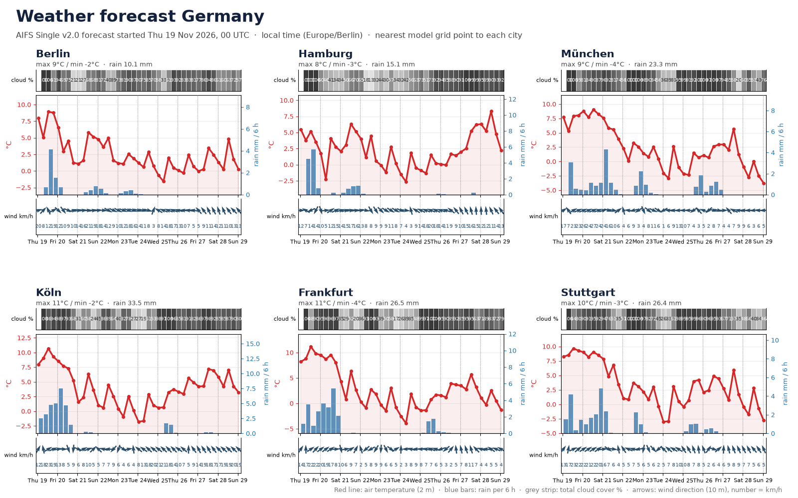

# AIFS weather forecast pipeline

Run ECMWF's machine-learned weather model **AIFS Single v2.0** from the latest real-time
ECMWF open data, and turn the forecast into weather cards. One command does both:

```bash
./predict_now.sh          # newest cycle → 10-day global forecast → weather cards for Germany
```

On a single RTX PRO 6000 (96 GB) the full 10-day forecast takes about **2 min 40 s**, and all
131 cards take another 40 s.




## What it does

1. Finds the newest 00/06/12/18 UTC cycle on [ECMWF open data](https://www.ecmwf.int/en/forecasts/datasets/open-data).
2. Runs [`ecmwf/aifs-single-2.0`](https://huggingface.co/ecmwf/aifs-single-2.0) with
   [anemoi-inference](https://github.com/ecmwf/anemoi-inference) for 10 days in 6 h steps.
   The output is GRIB on the native N320 grid.
3. Renders one card per variable (surface, 13 pressure levels, waves, constants) for a region,
   plus a per-city overview. An `index.html` gallery links them all.

Repeated runs skip cycles that are already finished, so `predict_now.sh` can run hourly from
cron and always keep the newest forecast.

## Setup and usage

See **[INSTRUCTION.MD](INSTRUCTION.MD)**. It covers environment setup with the pinned package
versions, the command-line options, cron, the output format, hardware notes and measured timings.

You need Linux with Python 3.12 and, in practice, an NVIDIA GPU with at least 24 GB of
memory. CPU inference works but is far too slow to be useful.

## Compatibility notes

The model's published version pins don't run the open-data command-line path as-is. This
repo includes small runtime fixes in `pipeline/compat/`; it does not modify installed
packages. The fixes are:

- an orography filter key mismatch between `anemoi-plugins-ecmwf-inference` 0.2.1 and
  `anemoi-transform` 0.1.16.post2
- a pure-PyTorch stand-in for `flash_attn`, so the checkpoint loads without flash-attn and
  runs on any GPU or CPU

Details are in [INSTRUCTION.MD](INSTRUCTION.MD#compatibility-fixes).

## Licence and attribution

The code in this repository is licensed under the [Apache License 2.0](LICENSE).

The model and data are not part of this repository and carry their own licences:

- AIFS Single v2.0 weights © ECMWF, licensed under [CC BY 4.0](https://creativecommons.org/licenses/by/4.0/).
- Forecast input: ECMWF open data, licensed under CC BY 4.0.
- The example cards in `docs/` are derived from both. Contains modified ECMWF data and
  forecasts, © ECMWF, CC BY 4.0.

This is an independent project. It is not affiliated with or endorsed by ECMWF.
